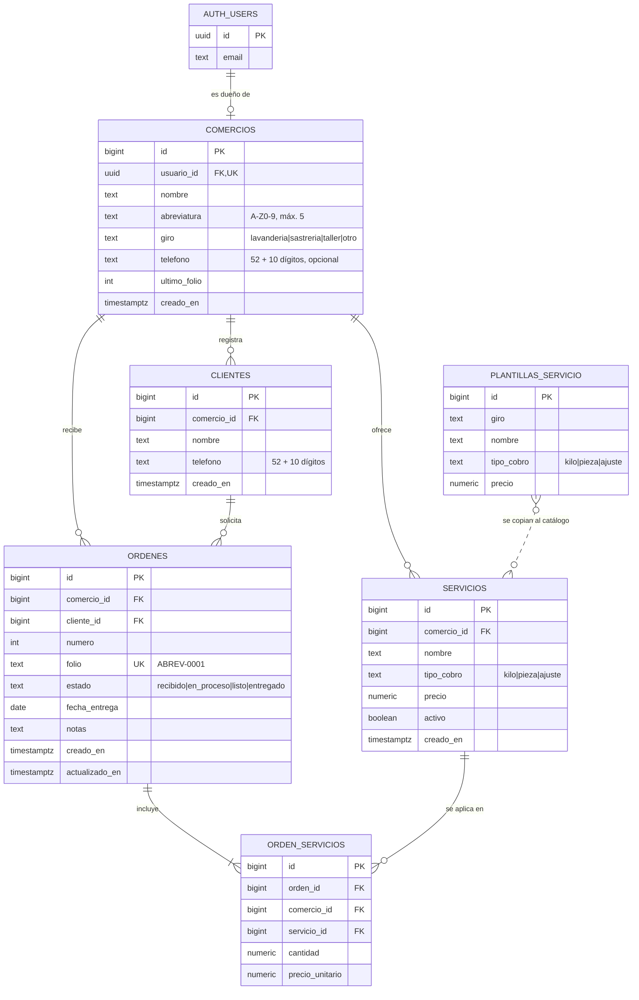

# PuntoListo · ACT-11 · Base de datos (Supabase / PostgreSQL)

> Documento técnico de referencia del esquema de base de datos (`docs/sql/001_esquema.sql`).

## 1. Decisiones de diseño

| Decisión | Cómo quedó |
|---|---|
| Usuario ↔ negocio | 1 usuario = 1 comercio (`comercios.usuario_id` es `UNIQUE`). |
| Folio | Consecutivo **por comercio** con su abreviatura: `LAV-0001`, `LAV-0002`… Lo asigna un trigger en la base de datos; Python **nunca** lo calcula. Pasa de 9999 a `LAV-10000` sin cortarse. |
| Abreviatura | 1 a 5 caracteres, solo `A-Z` y `0-9` (Python debe convertirla a mayúsculas antes de guardar). |
| Giros | Lista fija: `lavanderia`, `sastreria`, `taller`, `otro`. |
| Servicios de ejemplo | Tabla `plantillas_servicio`. Al configurar el negocio se llama a `cargar_servicios_ejemplo()` y se copian al catálogo, donde el comerciante los edita. |
| Tipo de cobro | `kilo`, `pieza` o `ajuste`, con `precio` guardado desde ahora (para las funciones e y f futuras). |
| Precio en la orden | `orden_servicios.precio_unitario` copia el precio del servicio **al momento de crear la orden**; si después cambia el catálogo, las órdenes viejas no se alteran. |
| Datos de la orden | Cliente, servicios con cantidad, fecha prometida de entrega (opcional) y notas (opcional, máx. 500 caracteres). |
| Estados | Fijos: `recibido` → `en_proceso` → `listo` → `entregado`. |
| Teléfonos | Formato internacional sin `+`: `52` + 10 dígitos (ej. `529931234567`), listo para `wa.me`. |
| Crear orden | Función `crear_orden()` que guarda encabezado y detalle en **una sola transacción**: o se guarda todo o nada. |
| Seguridad | RLS en todas las tablas: cada usuario solo ve las filas de su comercio. El rol `anon` (sin sesión) no tiene acceso a nada. |
| Integridad entre comercios | Llaves foráneas compuestas `(id, comercio_id)`: es imposible ligar una orden a un cliente o servicio de otro negocio, aunque alguien conozca su `id`. |

## 2. Cómo ejecutarlo en Supabase

1. Supabase → **SQL Editor** → **New query**.
2. Pega el SQL completo de la sección 3 y presiona **Run**. Debe terminar en "Success. No rows returned".
3. Revisa en **Table Editor** que aparezcan las 6 tablas, todas con el candado de RLS activo.
4. Revisa en **Database → Schema Visualizer** que se vean las relaciones (puedes tomar captura para tu documentación).
5. Revisa **Advisors → Security Advisor**: no debe haber alertas de RLS desactivado.

> ⚠️ Si necesitas volver a ejecutarlo desde cero, primero borra las tablas: `drop table if exists public.orden_servicios, public.ordenes, public.servicios, public.clientes, public.plantillas_servicio, public.comercios cascade;`

## 3. SQL completo

```sql
-- =====================================================================
-- PuntoListo · ACT-11 · Esquema de base de datos para Supabase
-- Ejecutar completo en: Supabase > SQL Editor > New query > Run
-- =====================================================================

-- ---------------------------------------------------------------------
-- 1. TABLAS
-- ---------------------------------------------------------------------

-- 1.1 Comercio: un negocio por usuario (relación 1:1 con auth.users)
create table public.comercios (
  id            bigint generated always as identity primary key,
  usuario_id    uuid not null unique
                references auth.users (id) on delete cascade,
  nombre        text not null check (length(trim(nombre)) between 2 and 80),
  abreviatura   text not null check (abreviatura ~ '^[A-Z0-9]{1,5}$'),
  giro          text not null
                check (giro in ('lavanderia', 'sastreria', 'taller', 'otro')),
  telefono      text check (telefono is null or telefono ~ '^52[0-9]{10}$'),
  ultimo_folio  integer not null default 0 check (ultimo_folio >= 0),
  creado_en     timestamptz not null default now()
);

-- 1.2 Plantillas de servicios por giro (datos de configuración, no del usuario)
create table public.plantillas_servicio (
  id          bigint generated always as identity primary key,
  giro        text not null
              check (giro in ('lavanderia', 'sastreria', 'taller', 'otro')),
  nombre      text not null,
  tipo_cobro  text not null check (tipo_cobro in ('kilo', 'pieza', 'ajuste')),
  precio      numeric(10,2) not null default 0 check (precio >= 0),
  unique (giro, nombre)
);

-- 1.3 Clientes del comercio
create table public.clientes (
  id           bigint generated always as identity primary key,
  comercio_id  bigint not null references public.comercios (id) on delete cascade,
  nombre       text not null check (length(trim(nombre)) between 2 and 80),
  telefono     text not null check (telefono ~ '^52[0-9]{10}$'),
  creado_en    timestamptz not null default now(),
  unique (comercio_id, telefono),
  unique (id, comercio_id)          -- necesario para las llaves foráneas compuestas
);

-- 1.4 Catálogo de servicios del comercio
create table public.servicios (
  id           bigint generated always as identity primary key,
  comercio_id  bigint not null references public.comercios (id) on delete cascade,
  nombre       text not null check (length(trim(nombre)) between 2 and 80),
  tipo_cobro   text not null check (tipo_cobro in ('kilo', 'pieza', 'ajuste')),
  precio       numeric(10,2) not null default 0 check (precio >= 0),
  activo       boolean not null default true,
  creado_en    timestamptz not null default now(),
  unique (comercio_id, nombre),
  unique (id, comercio_id)
);

-- 1.5 Órdenes (encabezado)
create table public.ordenes (
  id              bigint generated always as identity primary key,
  comercio_id     bigint not null references public.comercios (id) on delete cascade,
  cliente_id      bigint not null,
  numero          integer not null,      -- lo asigna el trigger (1, 2, 3…)
  folio           text not null,         -- lo asigna el trigger (LAV-0001)
  estado          text not null default 'recibido'
                  check (estado in ('recibido', 'en_proceso', 'listo', 'entregado')),
  fecha_entrega   date,
  notas           text check (notas is null or length(notas) <= 500),
  creado_en       timestamptz not null default now(),
  actualizado_en  timestamptz not null default now(),
  unique (comercio_id, numero),
  unique (comercio_id, folio),
  unique (id, comercio_id),
  -- El cliente debe pertenecer al MISMO comercio que la orden
  foreign key (cliente_id, comercio_id)
    references public.clientes (id, comercio_id) on delete restrict
);

-- 1.6 Detalle de la orden (servicios incluidos)
create table public.orden_servicios (
  id               bigint generated always as identity primary key,
  orden_id         bigint not null,
  comercio_id      bigint not null,
  servicio_id      bigint not null,
  cantidad         numeric(10,2) not null default 1 check (cantidad > 0),
  precio_unitario  numeric(10,2) not null check (precio_unitario >= 0),
  foreign key (orden_id, comercio_id)
    references public.ordenes (id, comercio_id) on delete cascade,
  foreign key (servicio_id, comercio_id)
    references public.servicios (id, comercio_id) on delete restrict
);

-- ---------------------------------------------------------------------
-- 2. ÍNDICES (PostgreSQL no indexa solo las llaves foráneas)
-- ---------------------------------------------------------------------
create index idx_clientes_comercio        on public.clientes (comercio_id);
create index idx_servicios_comercio       on public.servicios (comercio_id);
create index idx_ordenes_comercio_estado  on public.ordenes (comercio_id, estado);
create index idx_ordenes_cliente          on public.ordenes (cliente_id);
create index idx_orden_servicios_orden    on public.orden_servicios (orden_id);
create index idx_orden_servicios_servicio on public.orden_servicios (servicio_id);

-- ---------------------------------------------------------------------
-- 3. TRIGGERS
-- ---------------------------------------------------------------------

-- 3.1 Folio consecutivo por comercio: ABREVIATURA-0001
--     El UPDATE bloquea la fila del comercio, así dos órdenes simultáneas
--     nunca reciben el mismo número.
create or replace function public.asignar_folio()
returns trigger
language plpgsql
set search_path = ''
as $$
declare
  v_numero  integer;
  v_abrev   text;
begin
  update public.comercios
     set ultimo_folio = ultimo_folio + 1
   where id = new.comercio_id
  returning ultimo_folio, abreviatura into v_numero, v_abrev;

  if v_numero is null then
    raise exception 'Comercio % no encontrado', new.comercio_id;
  end if;

  new.numero := v_numero;
  new.folio  := v_abrev || '-' || lpad(v_numero::text, greatest(4, length(v_numero::text)), '0');
  return new;
end;
$$;

create trigger trg_ordenes_folio
  before insert on public.ordenes
  for each row execute function public.asignar_folio();

-- 3.2 Fecha de última actualización de la orden
create or replace function public.marcar_actualizado()
returns trigger
language plpgsql
set search_path = ''
as $$
begin
  new.actualizado_en := now();
  return new;
end;
$$;

create trigger trg_ordenes_actualizado
  before update on public.ordenes
  for each row execute function public.marcar_actualizado();

-- ---------------------------------------------------------------------
-- 4. FUNCIONES RPC (se llaman desde Python con supabase.rpc(...))
--    SECURITY INVOKER: corren con los permisos del usuario, así RLS aplica.
-- ---------------------------------------------------------------------

-- 4.1 Copia al catálogo los servicios de ejemplo del giro del comercio
create or replace function public.cargar_servicios_ejemplo()
returns integer
language plpgsql
security invoker
set search_path = ''
as $$
declare
  v_comercio  bigint;
  v_giro      text;
  v_total     integer;
begin
  select id, giro into v_comercio, v_giro
    from public.comercios
   where usuario_id = auth.uid();

  if v_comercio is null then
    raise exception 'Primero registra tu negocio';
  end if;

  insert into public.servicios (comercio_id, nombre, tipo_cobro, precio)
  select v_comercio, p.nombre, p.tipo_cobro, p.precio
    from public.plantillas_servicio p
   where p.giro = v_giro
  on conflict (comercio_id, nombre) do nothing;

  get diagnostics v_total = row_count;
  return v_total;
end;
$$;

-- 4.2 Crea una orden con sus servicios en UNA sola transacción
--     p_servicios: [{"servicio_id": 1, "cantidad": 3.5}, ...]
create or replace function public.crear_orden(
  p_cliente_id     bigint,
  p_servicios      jsonb,
  p_fecha_entrega  date default null,
  p_notas          text default null
)
returns table (id bigint, folio text)
language plpgsql
security invoker
set search_path = ''
as $$
declare
  v_comercio  bigint;
  v_orden     public.ordenes%rowtype;
  v_items     integer;
begin
  select c.id into v_comercio
    from public.comercios c
   where c.usuario_id = auth.uid();

  if v_comercio is null then
    raise exception 'Primero registra tu negocio';
  end if;

  if p_servicios is null
     or jsonb_typeof(p_servicios) <> 'array'
     or jsonb_array_length(p_servicios) = 0 then
    raise exception 'La orden debe incluir al menos un servicio';
  end if;

  insert into public.ordenes (comercio_id, cliente_id, fecha_entrega, notas)
  values (v_comercio, p_cliente_id, p_fecha_entrega, nullif(trim(p_notas), ''))
  returning * into v_orden;

  insert into public.orden_servicios
    (orden_id, comercio_id, servicio_id, cantidad, precio_unitario)
  select v_orden.id, v_comercio, s.id,
         coalesce((item ->> 'cantidad')::numeric, 1), s.precio
    from jsonb_array_elements(p_servicios) as item
    join public.servicios s
      on s.id = (item ->> 'servicio_id')::bigint
     and s.comercio_id = v_comercio
     and s.activo;

  get diagnostics v_items = row_count;
  if v_items <> jsonb_array_length(p_servicios) then
    raise exception 'Uno o más servicios no existen o están inactivos';
  end if;

  return query select v_orden.id, v_orden.folio;
end;
$$;

-- ---------------------------------------------------------------------
-- 5. SEGURIDAD: ROW LEVEL SECURITY (RLS)
-- ---------------------------------------------------------------------
alter table public.comercios           enable row level security;
alter table public.plantillas_servicio enable row level security;
alter table public.clientes            enable row level security;
alter table public.servicios           enable row level security;
alter table public.ordenes             enable row level security;
alter table public.orden_servicios     enable row level security;

-- 5.1 Comercios: cada usuario ve y edita solo su propio negocio
create policy comercios_select on public.comercios
  for select to authenticated
  using (usuario_id = (select auth.uid()));

create policy comercios_insert on public.comercios
  for insert to authenticated
  with check (usuario_id = (select auth.uid()));

create policy comercios_update on public.comercios
  for update to authenticated
  using (usuario_id = (select auth.uid()))
  with check (usuario_id = (select auth.uid()));

-- 5.2 Plantillas: cualquier usuario con sesión puede leerlas (no editarlas)
create policy plantillas_select on public.plantillas_servicio
  for select to authenticated
  using (true);

-- 5.3 Tablas del negocio: solo filas cuyo comercio pertenece al usuario
create policy clientes_propios on public.clientes
  for all to authenticated
  using (comercio_id in (select c.id from public.comercios c where c.usuario_id = (select auth.uid())))
  with check (comercio_id in (select c.id from public.comercios c where c.usuario_id = (select auth.uid())));

create policy servicios_propios on public.servicios
  for all to authenticated
  using (comercio_id in (select c.id from public.comercios c where c.usuario_id = (select auth.uid())))
  with check (comercio_id in (select c.id from public.comercios c where c.usuario_id = (select auth.uid())));

create policy ordenes_propias on public.ordenes
  for all to authenticated
  using (comercio_id in (select c.id from public.comercios c where c.usuario_id = (select auth.uid())))
  with check (comercio_id in (select c.id from public.comercios c where c.usuario_id = (select auth.uid())));

create policy orden_servicios_propios on public.orden_servicios
  for all to authenticated
  using (comercio_id in (select c.id from public.comercios c where c.usuario_id = (select auth.uid())))
  with check (comercio_id in (select c.id from public.comercios c where c.usuario_id = (select auth.uid())));

-- ---------------------------------------------------------------------
-- 6. PERMISOS (los visitantes sin sesión, rol "anon", no tienen acceso)
-- ---------------------------------------------------------------------
revoke all on public.comercios, public.plantillas_servicio, public.clientes,
              public.servicios, public.ordenes, public.orden_servicios from anon;

grant select, insert, update on public.comercios to authenticated;
grant select on public.plantillas_servicio to authenticated;
grant select, insert, update, delete
  on public.clientes, public.servicios, public.ordenes, public.orden_servicios
  to authenticated;

revoke execute on function public.cargar_servicios_ejemplo() from public, anon;
revoke execute on function public.crear_orden(bigint, jsonb, date, text) from public, anon;
grant  execute on function public.cargar_servicios_ejemplo() to authenticated;
grant  execute on function public.crear_orden(bigint, jsonb, date, text) to authenticated;

-- Las funciones de trigger no deben llamarse por la API
revoke execute on function public.asignar_folio()      from public, anon, authenticated;
revoke execute on function public.marcar_actualizado() from public, anon, authenticated;

-- ---------------------------------------------------------------------
-- 7. DATOS INICIALES: plantillas de servicios por giro
--    (precios de ejemplo; cada comercio los edita en su catálogo)
-- ---------------------------------------------------------------------
insert into public.plantillas_servicio (giro, nombre, tipo_cobro, precio) values
  ('lavanderia', 'Lavado por kilo',                'kilo',   30),
  ('lavanderia', 'Lavado y planchado por kilo',    'kilo',   45),
  ('lavanderia', 'Planchado por pieza',            'pieza',  15),
  ('lavanderia', 'Edredón o cobija',               'pieza', 120),
  ('sastreria',  'Dobladillo de pantalón',         'ajuste', 60),
  ('sastreria',  'Ajuste de cintura',              'ajuste', 80),
  ('sastreria',  'Cambio de cierre',               'ajuste', 70),
  ('sastreria',  'Confección de prenda',           'pieza', 350),
  ('taller',     'Diagnóstico',                    'pieza', 100),
  ('taller',     'Reparación general',             'ajuste',250),
  ('taller',     'Cambio de pieza',                'pieza', 150),
  ('otro',       'Servicio general',               'pieza',   0);
```

## 4. Diagrama entidad-relación

Para verlo como imagen: pégalo en https://mermaid.live y exporta PNG/SVG. GitHub también lo muestra en la vista previa del Markdown.



**Cardinalidades:** un usuario tiene 0 o 1 comercio; un comercio tiene muchos clientes, servicios y órdenes; un cliente tiene muchas órdenes; una orden incluye **al menos un** servicio (`orden_servicios`, tabla intermedia que resuelve la relación muchos a muchos entre órdenes y servicios). Las plantillas no tienen llave foránea: solo se copian al catálogo.

## 5. Pruebas de verificación (criterio de aceptación: "un comerciante no puede ver datos de otro")

El SQL Editor de Supabase entra como administrador y **se salta RLS**, así que las pruebas reales de aislamiento se hacen de dos formas:

- **Desde la app (recomendado):** registra 2 cuentas (una lavandería y una sastrería), crea un cliente y una orden en cada una y comprueba que ninguna ve los datos de la otra.
- **Desde el SQL Editor:** en la barra inferior cambia el rol a **authenticated** y elige un usuario para "impersonar"; las consultas se ejecutan como ese usuario.

Casos ya probados con este esquema (PostgreSQL simulando Supabase):

| # | Caso | Resultado esperado |
|---|---|---|
| 1 | Usuario A crea su comercio `LAV` y carga ejemplos | 4 servicios de lavandería |
| 2 | A crea dos órdenes | Folios `LAV-0001` y `LAV-0002` |
| 3 | Teléfono sin `52` (`9931234567`) | Error de validación |
| 4 | Estado inválido (`perdido`) | Error de validación |
| 5 | Orden sin servicios | Error "La orden debe incluir al menos un servicio" |
| 6 | Usuario B (`SAS`) consulta tablas | Ve 0 clientes y 0 órdenes de A |
| 7 | B crea orden con el cliente de A | Error de llave foránea |
| 8 | B usa un servicio de A | Error "Uno o más servicios no existen…" |
| 9 | B inserta un cliente en el comercio de A | Bloqueado por RLS |
| 10 | B intenta modificar órdenes de A | 0 filas afectadas |
| 11 | Primera orden de B | Folio `SAS-0001` (consecutivo independiente) |
| 12 | Usuario sin sesión (`anon`) | "permission denied" |
| 13 | Orden número 10 000 | Folio `LAV-10000` |

## 6. Notas de integración con Python

- **Cliente de Supabase por petición, con el token del usuario.** Crear el cliente con `SUPABASE_URL` y `SUPABASE_KEY` (clave publishable/anon) y, antes de consultar, aplicar el token de la sesión: `cliente.postgrest.auth(access_token)`. Así `auth.uid()` funciona y RLS filtra solo. **Nunca** usar la clave `service_role`/`secret` en la app.
- **No enviar `numero` ni `folio`** al crear órdenes: los asigna el trigger.
- **Crear comercio:** insertar en `comercios` con `usuario_id` = id del usuario en sesión, `abreviatura` en mayúsculas; luego `cliente.rpc("cargar_servicios_ejemplo").execute()`.
- **Crear orden:**
  ```python
  cliente.rpc("crear_orden", {
      "p_cliente_id": 1,
      "p_servicios": [{"servicio_id": 1, "cantidad": 3.5}, {"servicio_id": 3, "cantidad": 2}],
      "p_fecha_entrega": "2026-11-05",   # o None
      "p_notas": "Sin suavizante",        # o None
  }).execute()   # devuelve [{"id": ..., "folio": "LAV-0001"}]
  ```
- **Teléfono:** el formulario pide 10 dígitos; Python quita espacios/guiones, valida que sean 10 y antepone `52` antes de guardar.
- **Cambiar estado:** `update` sobre `ordenes` con `estado` en `recibido | en_proceso | listo | entregado`; `actualizado_en` se actualiza solo.
- **Etiquetas para mostrar** (la BD guarda claves sin acentos):
  - Giros: `lavanderia` → Lavandería, `sastreria` → Sastrería, `taller` → Taller de reparación, `otro` → Otro.
  - Estados: `recibido` → Recibido, `en_proceso` → En proceso, `listo` → Listo, `entregado` → Entregado.
  - Cobro: `kilo` → Por kilo, `pieza` → Por pieza, `ajuste` → Por ajuste.
- **Errores de la BD** llegan como excepciones `postgrest.exceptions.APIError`; capturarlas y mostrar un mensaje amable (ej. teléfono repetido → código `23505`).

## 7. Cambios posteriores

| Script | Fecha | Qué cambia |
|---|---|---|
| `docs/sql/002_permitir_borrar_cuenta.sql` | 30-oct-2026 | Las llaves `ordenes → clientes` y `orden_servicios → servicios` pasan a `on delete no action deferrable initially deferred`. Sigue prohibido borrar un cliente o servicio con órdenes, pero ya se puede eliminar una cuenta completa (usuario → comercio → todo lo demás) desde Supabase. |
